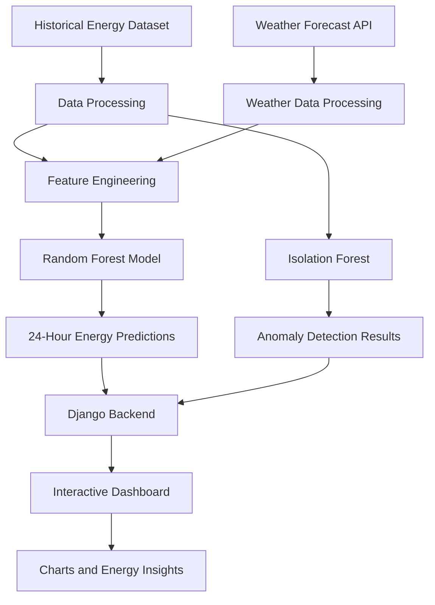

# ⚡ Smart Building Energy Forecaster

### AI-Powered Energy Consumption Prediction & Anomaly Detection System

<p align="center">
  A Machine Learning-powered web application that forecasts hourly building energy consumption and identifies unusual energy usage patterns.
</p>

<p align="center">
  
  
  
  
  
</p>

<p align="center">
  <a href="https://smart-building-energy-forecaster.onrender.com">🌐 Live Demo</a> •
  <a href="#-features">Features</a> •
  <a href="#-installation-and-setup">Installation</a> •
  <a href="#-machine-learning-approach">Machine Learning</a>
</p>

---

## 📌 1. Project Overview

**Smart Building Energy Forecaster** is an intelligent energy forecasting and anomaly detection system designed to support smarter energy management in buildings.

The application uses historical electricity consumption data, weather information, and time-based features to predict the next 24 hours of energy consumption.

It also applies an unsupervised Machine Learning algorithm to identify unusual patterns in historical energy usage.

The system provides an interactive web dashboard where users can explore energy predictions, weather information, average consumption, and detected anomalies.

### 🎯 Project Objectives

- Forecast future building energy consumption.
- Analyze historical electricity usage patterns.
- Understand the influence of weather on energy demand.
- Identify unusual energy consumption patterns.
- Present useful insights through an interactive dashboard.

---

## ✨ 2. Key Features

| Feature | Description |
|---|---|
| ⚡ Energy Forecasting | Predicts the next 24 hours of energy consumption. |
| 🤖 Machine Learning | Uses Random Forest Regression for forecasting. |
| 🌤️ Weather Integration | Retrieves hourly weather forecast data using Open-Meteo. |
| 🔍 Anomaly Detection | Identifies unusual historical energy consumption patterns. |
| 📊 Interactive Dashboard | Displays predictions and energy analytics using charts. |
| 📈 Energy Statistics | Calculates total and average predicted energy consumption. |
| 🔄 Auto Refresh | Refreshes dashboard information automatically. |
| ☁️ Cloud Deployment | Deployed using Render. |

---

## 🛠️ 3. Technology Stack

| Category | Technologies |
|---|---|
| Programming Language | Python |
| Backend Framework | Django |
| Machine Learning | Scikit-learn |
| Regression Algorithm | Random Forest Regressor |
| Anomaly Detection | Isolation Forest |
| Data Processing | Pandas, NumPy |
| Model Serialization | Joblib |
| Frontend | HTML, CSS, JavaScript |
| Data Visualization | Chart.js |
| Weather API | Open-Meteo |
| Database | SQLite |
| Version Control | Git, GitHub |
| Deployment | Render |

---

## 🧠 4. Machine Learning Approach

### A. Energy Consumption Forecasting

**Algorithm:** Random Forest Regressor

The forecasting model predicts hourly electricity consumption based on historical consumption patterns, weather conditions, and time-related information.

**Input Features:**

- Temperature
- Holiday indicator
- Hour of the day
- Day of the week
- Month
- Weekend indicator
- Previous 24-hour energy consumption (`lag_24`)
- Previous 48-hour energy consumption (`lag_48`)
- Previous 168-hour energy consumption (`lag_168`)
- Rolling average of the previous 24 hours
- Rolling average of the previous 168 hours

**Output:**

Predicted hourly energy consumption in kW.

### B. Energy Anomaly Detection

**Algorithm:** Isolation Forest

Isolation Forest is an unsupervised Machine Learning algorithm used to identify unusual observations in historical energy consumption data.

It helps highlight consumption patterns that differ significantly from normal historical behavior.

**Purpose:**
- Detect unusual energy consumption.
- Identify potentially abnormal usage patterns.
- Support further investigation of energy inefficiencies.

*Note: Anomaly detection identifies statistical irregularities; it does not independently confirm equipment failures.*

---

## ⚙️ 5. System Architecture



---

## 🔄 6. Project Workflow

1. **Data Collection:** Obtain historical building energy consumption records.
2. **Data Preprocessing:** Clean and prepare the energy dataset.
3. **Feature Engineering:** Generate time-based, lag, rolling average, and weather-related features.
4. **Model Training:** Train the Random Forest Regressor.
5. **Weather Integration:** Retrieve hourly weather forecast information through Open-Meteo.
6. **Energy Forecasting:** Generate the next 24 hourly energy predictions.
7. **Anomaly Detection:** Apply Isolation Forest to historical energy consumption.
8. **Dashboard Visualization:** Display predictions, statistics, weather information, and anomaly results.

---

## 📂 7. Project Structure

```text
Smart-Building-Energy-Forecaster/
│
├── config/
│   ├── settings.py
│   ├── urls.py
│   └── wsgi.py
│
├── dashboard/
│   ├── services/
│   │   ├── prediction.py
│   │   ├── weather.py
│   │   └── anomaly.py
│   ├── templates/
│   │   └── dashboard/
│   │       └── home.html
│   ├── views.py
│   └── urls.py
│
├── data/
│   └── building_energy.csv
│
├── ml_models/
│   ├── energy_forecasting_model.pkl
│   └── model_features.pkl
│
├── manage.py
├── requirements.txt
├── test_prediction.py
└── .gitignore
```

---

## 💻 8. Installation and Setup

Follow these steps to run the project locally.

### Step 1: Clone the Repository

```bash
git clone https://github.com/sayanmondalsayanmondal698-arch/Smart-Building-Energy-Forecaster.git
```

### Step 2: Navigate to the Project Directory

```bash
cd Smart-Building-Energy-Forecaster
```

### Step 3: Create a Virtual Environment

```bash
python -m venv venv
```

### Step 4: Activate the Virtual Environment

For Windows PowerShell:

```powershell
.\venv\Scripts\Activate
```

### Step 5: Install Dependencies

```bash
pip install -r requirements.txt
```

### Step 6: Apply Database Migrations

```bash
python manage.py migrate
```

### Step 7: Start the Django Development Server

```bash
python manage.py runserver
```

### Step 8: Open the Application

Visit:

```text
http://127.0.0.1:8000/
```

---

## ☁️ 9. Deployment

The application is deployed on **Render**.

- Source Code: GitHub
- Web Framework: Django
- Deployment Platform: Render
- Application Server: Gunicorn
- Static File Handling: WhiteNoise

🌐 **Live Application:** [Open Smart Building Energy Forecaster](https://smart-building-energy-forecaster.onrender.com)

---

## 🚀 10. Future Enhancements

The following improvements can extend the project:

- Real-time smart meter data integration.
- Support for multiple buildings.
- Advanced time-series forecasting models.
- Improved HVAC energy optimization recommendations.
- Historical energy consumption comparison.
- Advanced anomaly analysis and reporting.
- Downloadable energy analytics reports.

---

## 🎓 11. Learning Outcomes

Through this project, the following concepts were applied:

- Machine Learning model development.
- Regression-based prediction.
- Unsupervised anomaly detection.
- Data preprocessing and feature engineering.
- Weather API integration.
- Django web application development.
- Data visualization.
- GitHub version control and cloud deployment.

---

## 👨‍💻 12. Author

**Sayan Mondal**

Computer Science and Technology  
Specialization: Data Science

**GitHub:** [sayanmondalsayanmondal698-arch](https://github.com/sayanmondalsayanmondal698-arch)

**Project:** Smart Building Energy Forecaster

**Domain:** Machine Learning | Data Science | Energy Analytics

---

<p align="center">
  <b>⭐ If you find this project interesting, consider giving the repository a star!</b>
</p>

<p align="center">
  Built with Python, Django and Machine Learning.
</p>
